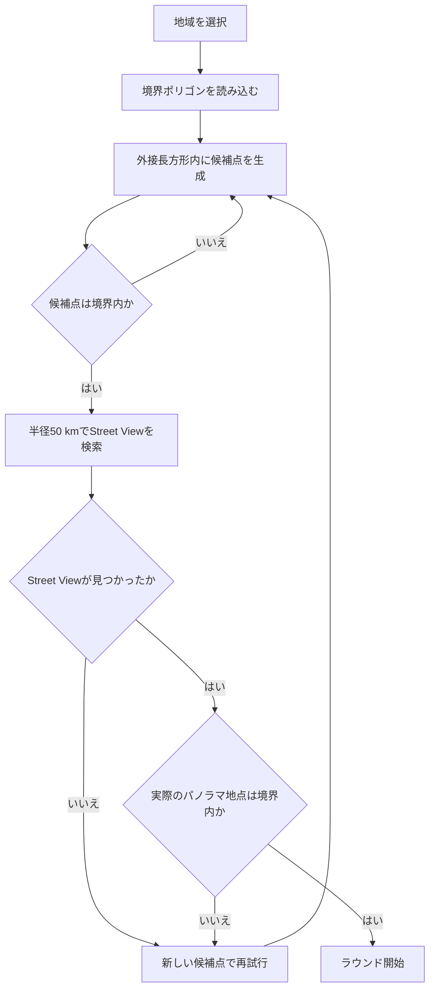

# 出題エリア選択の仕様

`index.html` に実装されている、世界全体または地域を指定した場合の出題地点の決定方法をまとめます。

## 選択肢と設定

- 「世界全体」では境界データを使用せず、緯度 `-60`～`70`、経度 `-180`～`180` の範囲から検索起点を生成します。
- 地域を選択した場合は、その地域の定義に指定された境界データを読み込みます。現在の全地域はNatural Earth由来の `world-atlas` を使用します。
- 選択内容はフリープレイ設定の `regionId` として `localStorage` に保存します。旧設定の `countryId` も読み込むため、保存済みの選択は引き継がれます。
- チャレンジモードの出題エリアは常に「世界全体」です。

## 出題地域の管理

`PLAY_REGIONS` はStreetGuessで練習対象として提供する地域を手動管理する一覧です。Google公式Street Viewカバレッジの完全な一覧ではありません。

各地域は次の名前付きフィールドを持ちます。

```js
{ id: '643', name: 'ロシア', boundary: { type: 'atlas', featureId: '643' } }
```

- `id`: 保存設定で使用する一意で安定した識別子。既存地域は互換性のため従来の3桁IDを維持します。新規地域のIDは国コードである必要はありません。
- `name`: メニュー表示名。
- `boundary`: 地理的境界の定義。`atlas` は `world-atlas` の地物IDを参照します。国以外の地域を将来追加する場合は、`{ type: 'geojson', geometry: { type: 'Polygon', coordinates: [...] } }` または `MultiPolygon` で境界を直接指定できます。

Issue #17でロシア、カザフスタン、グリーンランド、インド、チュニジア、アラブ首長国連邦、オマーン、レバノン、ベトナムを追加しました。

地域内の撮影済み・未撮影範囲は保持しません。メニュー表示時のカバレッジ事前検査も行いません。各ラウンドの候補地点検索時に `StreetViewSource.GOOGLE` の結果で公式画像の有無を判断するため、Google側で追加された地点も次回以降の探索対象になります。「全パノラマ」では従来どおり `StreetViewSource.DEFAULT` を使用します。

## 境界データの準備

選択地域のGeoJSONを、単一の `Polygon` または本土・離島などからなる `MultiPolygon` として扱います。日付変更線をまたぐ輪郭は、隣接する経度差が180度以内になるよう経度を連続化します。これにより、例えばロシアの東端を結ぶ辺が世界を横断する境界として扱われることを防ぎます。生成した候補点の経度は `-180`～`180` に戻し、境界内判定でも候補点と輪郭の経度を同じ範囲にそろえます。各ポリゴンについて外周を囲む緯度・経度の長方形を求め、次の値を概算の重みとして保持します。

```text
緯度幅 × 経度幅 × cos（中央緯度）
```

`cos`による補正は、高緯度ほど経度1度あたりの実距離が短くなることを考慮するためです。

## 地域を指定した候補点の生成

候補点は次の棄却サンプリングで生成します。

1. 本土や離島などのポリゴンを、外接長方形の概算面積に応じて選択する。
2. 選択した外接長方形内に、緯度・経度が一様なランダム地点を作る。
3. 地点がポリゴンの外周内にあり、内側の穴には入っていないことを確認する。
4. 境界外なら破棄して再試行し、境界内ならStreet Viewの検索起点として採用する。

候補点の生成は最大500回試行します。したがって、日本の外接長方形に韓国などが含まれていても、その地点は境界判定で破棄されます。クロアチアのように外接長方形に対する国土の割合が小さい地域では、隣国が出題されるのではなく、候補点の破棄回数が増えます。

## Street View地点の検索と再検証

候補点を中心として、半径50 km以内にある最寄りのStreet Viewを検索します。

- 世界全体では最大120回検索します。
- 地域指定では最大240回検索します。
- 「公式画像のみ」が有効な場合はGoogle公式のパノラマに限定します。

Street View APIが返す地点は検索起点そのものとは限りません。このため、地域指定時は返却された実際のパノラマ座標についても境界内か再確認します。地域外ならその結果を破棄し、新しい候補点から検索し直します。



## 得点計算のエリアサイズ

世界全体では固定値 `14916.862 km` を地図サイズとして使用します。地域指定では、境界全体を囲む範囲の対角線距離を地図サイズとして使用します。日付変更線をまたぐ地域については、経度の最大空白区間を除いた最短の経度範囲を求めます。

得点は、正解地点との距離とこの地図サイズから計算します。

```text
round(5000 × exp(-10 × 距離km ÷ 地図サイズkm))
```

## 制約と例外

- サンプリングは厳密な球面上の一様分布ではなく、緯度・経度と概算面積を使った近似です。
- 細長い地域、島が多い地域、外接長方形に対する国土面積が小さい地域では再試行が増えます。
- 境界判定は使用している境界データの精度に依存します。係争地域、細かな海岸線、Street View側の座標誤差などにより、現実の認識と一致しない可能性があります。

## 実装との対応

| 処理 | `index.html` の関数・定数 |
| --- | --- |
| 選択可能な地域 | `PLAY_REGIONS`, `populateRegionSelect` |
| 境界データの取得・変換 | `loadRegionGeometry`, `geometryPolygons` |
| 外接長方形と領域の重み | `polygonBounds`, `loadRegionGeometry` |
| 境界内判定 | `pointInRing`, `pointInPolygon`, `pointInRegion` |
| 候補点の生成 | `randomRegionPoint`, `randomLatLng` |
| Street View検索と返却地点の再検証 | `findRandomPano` |
| 得点用エリアサイズ | `regionMapSizeKm`, `calculateScore` |

これらの処理、検索半径、試行回数または得点基準を変更した場合は、この資料も同時に更新してください。

## 検証

`node --test tests/regions.test.cjs` で、地域選択・保存設定の互換性・境界内の候補生成・Street View検索結果の再検証を確認できます。実際のGoogle公式画像で各地域のラウンドを複数回開始する確認には、有効なGoogle Maps APIキーが必要です。
